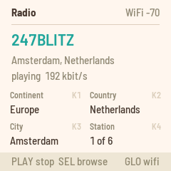
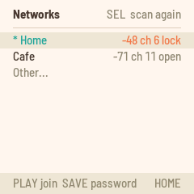
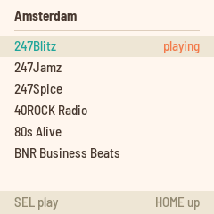
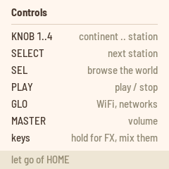
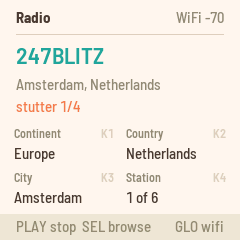
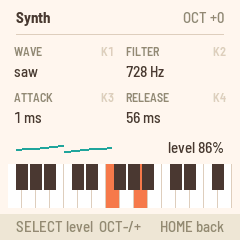

# Radio

Radio turns the M-VAVE FM-1 into a pocket internet radio. It joins a 2.4 GHz WiFi network and plays stations
from around the world from Radio Garden's map, MP3 and AAC (HE-AAC included). The white keys are punch-in
effects, ARP turns the keys into a small synth over the radio, SAVE keeps your favorite stations, and over USB
the FM-1 is a sound card you can record from.



---

## Contents

1. Install
2. Join a network
3. Listening
4. Favorites
5. Punch-in effects
6. The synth
7. Recording over USB
8. Troubleshooting
9. Known limits

---

## 1. Install

**Try it first:** the [Radio emulator](https://charlesvestal.github.io/fm1-radio/emu/) runs the same code in the
browser: the stations play, with the effects on the keys, through Radio's own decoders.

**Install:** open the [web installer](https://charlesvestal.github.io/fm1-radio/install/) in Chrome or Edge,
connect the FM-1 with a USB data cable and press Install. Don't unplug it while it's writing; when it finishes,
the FM-1 restarts into Radio.

**Go back:** "Back to the stock firmware", at the bottom of the same page, puts M-VAVE's firmware back.

> Installing other firmware is at your own risk. If the FM-1 ever won't start, hold **REC** while you switch it
> on: it starts in update mode, and the installer page can write a firmware again.

<details><summary>Install from the command line</summary>

Download the firmware file (`radio-VERSION.fwsc`) from the
[releases page](https://github.com/charlesvestal/fm1-radio/releases), get the Radio source from GitHub, install
Python 3 with `pip3 install mido python-rtmidi`, and run:

```
python3 base/tools/fm1_install.py radio-VERSION.fwsc
```

</details>

---

## 2. Join a network

The FM-1 joins 2.4 GHz networks only, open or WPA2 with a password. It can't see 5 GHz networks: if your router
has one name for both bands, it will still find the 2.4 GHz one.

With no network saved, the FM-1 starts on the list of networks around it, already scanning: turn **SELECT** to
yours and press **PLAY**, then type its password (steps 4 and 5 below).



1. Press **GLO** for the WiFi page.
2. Press **PLAY** to turn WiFi on, then **SEL** to see the networks around you. **SEL** again scans again.
3. Turn **SELECT** to a network. Each shows its signal (-50 is strong, -80 is weak), its channel, and "lock"
   if it needs a password.
4. For an open network or one you've saved, press **PLAY** to join. Otherwise press **SAVE** to type its
   password.
5. Type the password on the keys and press **PLAY** to save it and join. **HOME** cancels.

**A hidden network:** choose **Other...** (at the top while it scans, at the bottom after), type the network's
name and press **PLAY**, then its password (none for an open network) and **PLAY** again.

**Typing:** the keys type left to right, every key in turn, black ones too: the first 26 are a to z, and the
last key deletes. Hold **OCT−** and press a key for a capital; hold **OCT+** for the digits 0 to 9 and then
`space ! @ # $ % & * - _ . , ? + / :`. The screen shows a small keyboard with what each key types.

**Saved networks:** the FM-1 keeps six, the most recent first. With networks saved, it turns WiFi on at start,
scans, and joins the strongest saved network it hears; hearing none, it tries each saved one in turn, and tries
again shortly. To forget one, from a computer: `python3 base/tools/fm1_remote.py wifi saved` lists them,
`wifi forget N` forgets the one at N (0 is the first).

The FM-1 always joins with the same address (made from its flash chip's factory ID), so your router sees it as
one device, through updates and other firmwares.

---

## 3. Listening

| Control | What it does |
|---|---|
| **PLAY** | Play or stop. |
| **KNOB 1** | Continent. |
| **KNOB 2** | Country. |
| **KNOB 3** | Place: a city or town, A to Z. |
| **KNOB 4** or **SELECT** | Station in the place. |
| **MASTER** | Volume. |
| **FX** | Tap tempo for the effects. |
| **SEL** | Browse the list of continents, countries, places and stations. |
| **SAVE** | Favorites. |
| **ARP** | The synth. |
| **GLO** | The WiFi page, and back. |
| Hold **HOME** | The controls, on the screen. |

The knobs work as a dial: turn them, and the radio tunes once you stop. A new place takes a second or two: the
FM-1 asks Radio Garden for its stations (up to 100, as Radio Garden orders them) and plays the first. The screen
shows the station, its place and country, and whether it is playing or buffering. A station that drops out is
reconnected by itself.



In the browser, turn **SELECT** to move, press **SEL** to open a place or to play a station, and press **HOME**
to go up a level.

The FM-1 plays MP3 and AAC streams, HE-AAC ("AAC+") included; an HE-AAC v2 stream plays in mono. A few stations
can't play at all (HLS, AAC in an MP4 container, Ogg), and some are offline. The screen says so ("can't play
HLS", "station offline"): turn **KNOB 4** to the next one.

The FM-1 remembers the station and whether it was playing, and picks up there at the next start.



---

## 4. Favorites

Press **SAVE** for your favorites, up to 16. The list's top row adds the station playing. Turn **SELECT** to
move, press **SEL** to play a favorite, and **REC** to delete it. **HOME** (or **SAVE**) goes back.

The favorites are kept in the FM-1's flash, apart from everything else. Another firmware that uses the same
flash (LOOM-8's samples, for one) erases them.

---

## 5. Punch-in effects

While the radio plays, the 16 white keys light up. Hold a white key for its effect, and let go to stop it. Hold
several to mix them. The screen shows what is held, and a held key's light goes out.

| White key | Effect |
|---|---|
| 1 | Low-pass filter |
| 2 | High-pass filter |
| 3 | Telephone: a narrow, driven band |
| 4 | Bitcrush |
| 5 | Stutter, 1/8: repeats the last eighth note |
| 6 | Stutter, 1/16 |
| 7 | Stutter, 1/32 |
| 8 | Stutter, 1/64 |
| 9 | Tape stop |
| 10 | Reverse |
| 11 | Chop, 1/8: open for the first half of each eighth note, from your press |
| 12 | Chop, 1/16 |
| 13 | Ring modulator |
| 14 | Half speed |
| 15 | Mute |
| 16 | Lo-fi |



The stutters, tape stop, reverse and half speed play back the last quarter second, in mono. Only one of them
plays at a time: with two held, the lower key wins. The filters, crushers, ring modulator, chops and mute work on
top of them.

**Tap tempo.** The stutters and chops follow a tempo, 120 BPM at start. Tap **FX** on Home in time with the
music to set it: the last four taps count, and a pause of two seconds starts a new count. The screen shows the
tempo for two seconds, and the FX light flashes on the beat. Below about 108 BPM the 1/8 stutter plays a 1/16
instead (the history holds about a quarter second).

---

## 6. The synth

Press **ARP** to play the keys: a 4-voice synth over whatever the radio plays, or on its own.



| Control | What it does |
|---|---|
| **KNOB 1** | The wave: sine, triangle, saw, square, and everything between. |
| **KNOB 2** | Filter: a low-pass, 80 Hz to 12 kHz. |
| **KNOB 3** | Attack: 1 ms to 2 s. |
| **KNOB 4** | Release: 5 ms to 3 s. |
| **SELECT** | The synth's level against the radio. |
| **OCT-** / **OCT+** | Octaves, two each way. |
| **HOME** or **ARP** | Back to the radio (the keys are the effects again). |

Its settings are kept, a few seconds after a change.

---

## 7. Recording over USB

Plugged into a computer, the FM-1 is also a USB sound card, "RADIO FM-1" (stereo, 44.1 kHz). Choose it as the
input in any audio app to record the radio, the effects and the synth as you hear them (after MASTER).

---

## 8. Troubleshooting

**It can't find my network, or keeps dropping it.** The FM-1's antenna is small: where a phone shows full bars,
the FM-1 may see -75 or less, and below about -80 it struggles. Move it nearer the router, or check that the
router's 2.4 GHz band is on. A phone's hotspot works well as a test.

**A station won't play.** Some stations are offline or use a format the FM-1 can't play (see Listening): turn
**KNOB 4** to the next.

**"Report a problem".** If the FM-1 crashes, or won't stay on your WiFi, connect it by USB and open the
[installer page](https://charlesvestal.github.io/fm1-radio/install/): "Report a problem" reads its crash record
and log, ready to copy into an issue on [GitHub](https://github.com/charlesvestal/fm1-radio/issues). Don't
switch the FM-1 off first: the record survives a restart, not switching off.

---

## 9. Known limits

- 2.4 GHz WiFi only, open or WPA2 with a password.
- MP3 and AAC streams; HE-AAC v2 plays in mono, and HLS, MP4 and Ogg streams don't play.
- A place shows up to 100 stations.
- Server certificates aren't checked: the connection to a station or to Radio Garden is encrypted, but not
  verified.

Radio is open source (MPL-2.0), built on fm1-base and felucca-bsp, from Felucca by Leo Kuroshita (Hügelton
Instruments). The stations and the map are Radio Garden's. Radio Garden isn't affiliated with Radio. M-VAVE and
FM-1 are trademarks of their owners; Radio is not affiliated with M-VAVE.
